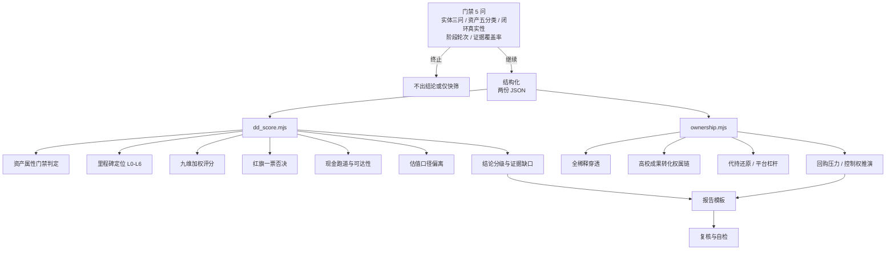

# bci-investment-dd

**脑机接口投资尽职调查框架** —— 一套可执行、可复算、可校准的 BCI 投前尽调方法论。

[](LICENSE)
[](https://nodejs.org)
[](#工程约定)
[](CHANGELOG.md)

---

## 为什么需要它

脑机接口在 2026 年同时出现了两个相反的事实: 一边是资本与政策的集中涌入, 一边是绝大多数标的无法用同一把尺子衡量。

真正的问题不在「看不看好这个赛道」, 而在**用错了尺子**:

- 植入式三类产品与消费级脑电头环, 研发周期、资金消耗、壁垒高度、退出路径完全不同。前者可以用里程碑折现的期权思路讨论, 后者只能回到收入、扣非利润、市占与复购。**把消费级资产按硬科技期权定价, 是这个赛道最贵的错误。**
- 单项监测设备 (只有采集, 没有实时解码与反馈) 常被包装成脑机接口平台。监管口径对此已有明确边界, 尽调必须先做这一层判定。
- 长周期赛道与短存续期基金错配, 常被误读为「项目选错了」。同样的标的, 换一种资金属性结论可能完全不同。

本框架把这三类问题前置成**门禁**, 再用九个维度、109 项检查项与 44 条红旗逐层收敛, 最后把评分、跑道、里程碑定位、估值偏离与股权穿透交给两个确定性脚本完成 —— 数字不靠口算, 结论可被复算。

## 核心设计



四层结构:

| 层 | 内容 | 载体 |
|---|---|---|
| 门禁 | 5 个问题决定要不要往下做、用哪把尺子 | [`references/00-gate.md`](references/00-gate.md) |
| 评估 | 9 维 109 项检查项, 每条带来源标记 | [`references/01`](references/01-asset-class.md) – [`09`](references/09-team-org.md) |
| 红线 | 44 条红旗, 其中 15 条一票否决 | [`references/red-flags.md`](references/red-flags.md) |
| 计算 | 评分聚合、跑道、里程碑、估值偏离、股权穿透 | [`scripts/`](scripts) |

## 快速开始

零依赖, 只需 Node ≥ 18。

```bash
git clone https://github.com/<your-org>/bci-investment-dd.git
cd bci-investment-dd

# 看输入格式与输出结构(内置示例故意埋入多处告警)
node scripts/dd_score.mjs --example
node scripts/ownership.mjs --example

# 用自己的数据跑
node scripts/dd_score.mjs examples/01-implant-class3.json
node scripts/ownership.mjs examples/03-cap-table.json
```

输出是 Markdown, 可直接粘进尽调报告。第一至七节的表格与数字**逐字粘贴**, 报告模板的节号与脚本节号一一对应。

## 目录结构

```
bci-investment-dd/
├── SKILL.md                      # Agent Skill 入口: 三条原则 + 五步工作流 + 阶段门禁路由
├── scripts/
│   ├── dd_score.mjs              # 门禁 / 里程碑 / 九维 / 红旗 / 跑道 / 估值偏离 / 结论
│   └── ownership.mjs             # 全稀释穿透 / 权属链 / 代持 / 平台杠杆 / 回购 / 控制权
├── references/
│   ├── 00-gate.md                # 门禁五问与资产五分类
│   ├── 01-asset-class.md ... 09-team-org.md   # 九维分片, 共 109 项检查项
│   ├── red-flags.md              # 44 条红旗编号真源
│   ├── milestones.md             # L0-L6 阶梯与各级证据清单
│   ├── valuation-framework.md    # 三种口径族与偏离判定
│   ├── evidence-checklist.md     # 按维度的取证清单
│   ├── sourcing-rules.md         # 来源四级、时点要求、禁止写法
│   ├── sources.md                # 外部事实登记表(已核 / 待核)
│   └── glossary.md               # 中英术语与表述约定
├── assets/
│   ├── schema/                   # 两份输入 JSON Schema
│   └── templates/                # 报告模板 + 资料索取函模板
├── examples/                     # 三组脱敏示例与脚本真实输出
└── CHANGELOG.md
```

## 九维与里程碑

| 维度 | 检查项 | 看什么 |
|---|---|---|
| D1 资产属性与估值范式 | 13 | 叙事线与收入线是否错位, 口径族是否选错 |
| D2 临床需求与适应症价值 | 10 | 风险收益比是否成立, 是否存在低风险替代 |
| D3 技术真实性与工程化 | 14 | 在线闭环、跨被试泛化、六件套完整性、伪前沿识别 |
| D4 注册路径与临床证据 | 14 | 分类界定、型检时点、对照设计与主要终点 |
| D5 商业化与支付 | 12 | 谁付钱、付多少、能否复制 |
| D6 财务质量与现金跑道 | 11 | 剔除补助与关联方后的经营性收入 |
| D7 资本结构、条款与退出 | 11 | 退出通道硬门槛、回购压力、估值倒挂 |
| D8 法律、IP、数据与控制权 | 12 | 权属链、知情同意、宣传合规 |
| D9 组织、创始人与产业生态位 | 12 | 单点依赖、关键角色缺位、BD 能力 |

里程碑七级 (L0 → L6), 每级对应一组可验证证据, 也是估值跳升的唯一合法依据:

`L0 原理验证 → L1 型式检验与标准符合性 → L2 大动物安全性 → L3 探索性临床 → L4 多中心确证性 → L5 注册申报与审评 → L6 注册证与商业化准入`

二类康复与消费级走分支路径, 不经过大动物实验与确证性临床 —— 这是资产属性分流在流程上的体现。

## 工程约定

- **零依赖。** 只用 Node 标准库, 不联网, 不写文件, 输出到 stdout。
- **能算多少算多少。** 输入缺失只产出 `## 警告`, 不抛异常: 问题集中到最后一段, 每条带主体名与具体数值。
- **节号是契约。** 脚本输出 `## 一` 至 `## 七` 与末段 `## 警告`, 报告模板按同一套节号组织, 三方对齐。
- **参数可校准。** 权重、阶段因子、倍数区间、里程碑耗时都是常量表, 属方法学假设而非市场事实。换口径就改常量表, 并在报告里声明版本。
- **不口算。** 所有数字以脚本 stdout 为准, 禁止四舍五入改写或在报告里补算脚本没输出的指标。

## 方法论溯源

本框架由三部分合成:

1. **结构化尽调骨架** —— 六维清单 (业务 / 财务 / 法律 / 技术 / 临床监管 / 团队) 与 13 条致命红旗的原始积累, 整体迁入九维, 无条目丢失; 映射关系见 [`references/red-flags.md`](references/red-flags.md) 附录。
2. **股权控制类尽调的工程范式** —— 「数字以脚本为准、references 按阶段门禁、报告模板与脚本节号互锁」的组织方式, 使方法论从文档变成可执行流程。
3. **行业公开观察的概念贡献** —— K 型分化的资本结构、医疗级与消费级两类资产的估值范式鸿沟、里程碑与估值跳升的对应关系、期权定价思路在长周期硬科技上的适用前提。这些属观点与框架性判断, 具体数字一律按 [`references/sourcing-rules.md`](references/sourcing-rules.md) 的级别要求重新核验, 未核者进待核区, 不进结论。

监管与标准事实均登记在 [`references/sources.md`](references/sources.md), 含发布日、访问日与级别, 例如:

| 事实 | 来源级别 |
|---|---|
| 脑机接口医疗器械须同时具备四项核心技术特征; 单向采集或单向刺激不属于该类产品 (2026 年第 24 号通告) | 一级 · 国家药监局 |
| 分类编码 12-00 / 09-00 / 19-00 与二类康复的 AI 边界 | 一级 · 国家药监局 |
| YY/T 2029—2026 人工智能脑电数据集质量要求 (2027-09-01 实施) | 一级 · 标准平台 |
| 科创板第五套标准: 预计市值 ≥ 40 亿元, 医药企业需一项核心产品获准开展二期临床 | 一级 · 上交所规则 |
| 港交所 18A: 上市市值 ≥ 15 亿港元, 核心产品通过概念阶段等 | 一级 · 港交所规则 |
| 七部门《关于推动脑机接口产业创新发展的实施意见》2027 / 2030 目标 | 一级 · 中国政府网 |

## 边界与免责

- 本框架输出的是**尽调流程指标与偏离提示**, 不构成估值结论、不构成投资建议, 亦不构成法律、监管或会计意见。
- 权重、阈值、倍数区间是方法学参数, 使用前须按自身基金口径校准; 里程碑耗时是行业经验区间, 不是对具体标的的工期承诺。
- 控制权推演为按稀释比例线性折算的近似, 不替代律师的章程逐条核对。
- 涉及监管要求时, 一律以现行有效的法规、指导原则与审评要求原文为准。
- 示例数据全部虚构, 不得作为可比交易或估值参照。

## 贡献

见 [`CONTRIBUTING.md`](CONTRIBUTING.md)。欢迎补充: 未覆盖的监管路径、可复算的估值参数、脱敏案例。提交前请确保新增数字带来源, 并按本框架的登记格式写入。

## License

[MIT](LICENSE)
