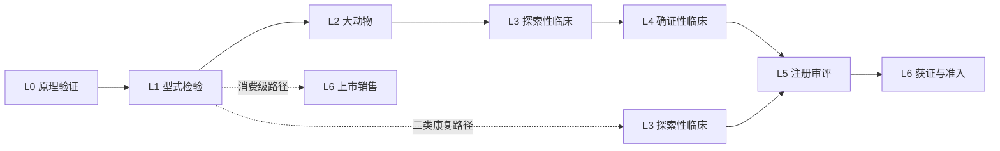

# 里程碑阶梯 L0 至 L6

> 阶段门禁: `SKILL.md` 阶段 2 开始前必读 —— 后续的跑道、口径、结论都以当前级数为锚
> 与脚本契约: 本文件是 L 级编号与证据 key 的唯一真源, 与 `scripts/dd_score.mjs` 的 `MILESTONES` 一一对应。改动须同步脚本、报告模板与 `04-regulatory.md`

## 为什么用里程碑做锚

脑机接口企业的估值跳升不连续, 而是阶梯式的: 每一个物理里程碑的跨越都对应一次数倍级重估。因此「当前在第几级」比「今年收入多少」更能解释估值, 也更能预测下一轮的可能时点。

前提只有一个: **里程碑必须可核**。无法核验的「已进入临床」不构成里程碑, 只构成叙事。

## L0 实验室原理验证(POC)

- **定义**: 在受控条件下, 用真实神经信号驱动真实外部设备, 完成闭环任务。
- **退出判据**: 有在线实时的闭环演示, 且受试者不是开发者本人。
- **必备证据**(脚本 key): `subject` 受试者与样本说明 / `task` 在线实时任务范式 / `record` 可复现实验记录
- **典型耗时**: 3 至 9 个月
- **常见伪达成**: 用离线数据集上的交叉验证结果声称完成 POC; 用开发者自测数据; 演示时只展示成功试次。

## L1 型式检验与标准符合性

- **定义**: 通过具备资质的检测机构在电气安全、电磁兼容、生物相容性方面的检测。
- **退出判据**: 取得检测报告, 且设计与检测样品版本一致。
- **必备证据**: `electrical` 电气安全报告 / `emc` 电磁兼容报告 / `biocompat` 生物相容性报告 / `software` 软件与算法文档 / `dataset` YY/T 2029 数据集自评
- **典型耗时**: 6 至 12 个月
- **常见伪达成**: 用研发阶段的内部测试报告替代第三方检测; 检测样品与量产设计不同版本; 采用 AI 算法但未按 YY/T 2029—2026 规范数据集。

> YY/T 2029—2026 于 2026-08-24 发布、2027-09-01 实施。2026 年内推进型检的项目若不提前对齐, 存在返工风险。

## L2 大动物安全性评价

- **定义**: 在大型动物体内验证长期安全性与信号稳定性。
- **退出判据**: 在体 6 个月以上的安全性与阻抗数据, 且有组织病理结论。
- **必备证据**: `survival` 在体 ≥6 个月存活与安全 / `impedance` 阻抗稳定性趋势 / `pathology` 组织病理与排异评估
- **典型耗时**: 9 至 18 个月
- **常见伪达成**: 用在体 1 至 3 个月的数据声称长期安全; 只报存活率不报阻抗漂移; 把影像学随访当组织病理结论。

> 非侵入式产品不走本节点, 但同样需要给出安全干预参数的理论边界与系统长期稳定性数据。这类数据可以并入 L1 或 L3。

## L3 探索性临床(IIT / 可行性研究)

- **定义**: 在少量患者身上验证安全性与初步有效性, 为确证性临床设计提供依据。
- **退出判据**: 有伦理批件、有备案或审批文件、有完整例数与随访表。
- **必备证据**: `ethics` 伦理批件 / `filing` 临床备案或审批文件 / `cases` 例数与随访表 / `ae` 安全性事件汇总
- **典型耗时**: 9 至 18 个月
- **常见伪达成**: 把伦理批件当临床数据; 用研究者发起的个案系列充当 IIT; 例数不足且无随访。

## L4 多中心确证性临床

- **定义**: 按预设方案在多中心完成的注册用临床试验。
- **退出判据**: 方案与统计分析计划在揭盲前锁定; 主要终点达到预设; 有期中或结题报告。
- **必备证据**: `protocol` 方案与对照设计 / `endpoint` 主要终点预设 / `sites` 中心数与例数 / `report` 期中或结题报告
- **典型耗时**: 18 至 36 个月(脚本按 1.2 缓冲系数计)
- **常见伪达成**: 用单中心数据声称多中心; 事后更改主要终点; 只报最优中心的数据。

## L5 注册申报与技术审评

- **定义**: 向监管机构提交注册申请并完成技术审评。
- **退出判据**: 取得受理通知书, 完成发补答复, 通过体系核查。
- **必备证据**: `acceptance` 受理通知书 / `deficiency` 发补意见与答复 / `audit` 体系核查结论
- **典型耗时**: 9 至 18 个月(脚本按 1.15 缓冲系数计)
- **常见伪达成**: 把受理当获证; 隐瞒发补次数; 体系核查发现问题后未整改即对外宣称「即将获批」。

## L6 注册证与商业化准入

- **定义**: 取得注册证并完成进入市场的必要条件。
- **退出判据**: 有注册证、有医保编码或挂网、有首批入院或订单。
- **必备证据**: `cert` 医疗器械注册证 / `reimburse` 医保编码或省级挂网 / `order` 首批入院或订单
- **典型耗时**: 3 至 12 个月
- **常见伪达成**: 有证无编码(拿到了却卖不了); 有挂网无采购(进了目录但医院不买); 把一次性科研采购当商业化订单。

## 二类与消费级的分支路径

| 资产类别 | 主干路径 | 省略的节点 | 理由 |
|---|---|---|---|
| 医疗级·植入式/非侵入三类 | L0 → L1 → L2 → L3 → L4 → L5 → L6 | 无 | 高风险, 全链条 |
| 医疗级·二类康复 | L0 → L1 → L3 → L5 → L6 | 省略 L2(大动物), L4 可简化 | 非侵入、无植入创伤、临床风险相对可控 |
| 消费级·非器械 | L0 → L1 → L6 | 省略 L2、L3、L4、L5 | 不走医疗器械注册, 但仍需基础安全与电磁兼容 |
| 科研服务工具 | L0 → L1 → L6 | 省略 L2 至 L5 | 面向研究者, 不构成医疗器械 |

二类路径有一个前提必须核实: **仅用于脑卒中肢体运动功能康复训练, 且未采用人工智能技术**。三个条件缺一, 就回到三类全链条。

## 里程碑与估值的对应(只讲方法)

估值跳升来自「不确定性减少」, 不来自「进度推进」。因此每一步的价值增量取决于它消除了多少不确定性:

| 跨越 | 消除的主要不确定性 | 对估值的影响机制 |
|---|---|---|
| L0 → L1 | 技术能否做成合规产品 | 从技术风险转为工程风险 |
| L1 → L2 | 长期植入是否安全 | 从工程风险转为临床风险 |
| L2 → L3 | 人体是否获益 | 首次出现人体数据, 可比性提升 |
| L3 → L4 | 获益是否可重复 | 从「可能有效」转为「证据支持」 |
| L4 → L5 | 监管是否认可 | 从临床风险转为审批时点风险 |
| L5 → L6 | 能否变现 | 首次可用收入法定价 |

期权法的四个输入(当前级、下一级达成概率、成功后价值、折现率)与偏离度判定见 `valuation-framework.md`。该文件只给方法, 不给参数结论。

## 与其他文件的接口

- `04-regulatory.md` 决定每一级的证据门槛与法定时限。
- `dd_score.mjs` 第二节按 `MILESTONE_PATHS` 取当前级与下一级; 第五节的跑道对比用下一级耗时中值 × 缓冲系数。
- 已达成但证据不完整的节点会单独告警 —— 「声称 done 但证据不足」是本赛道伪达成的主要形态。
